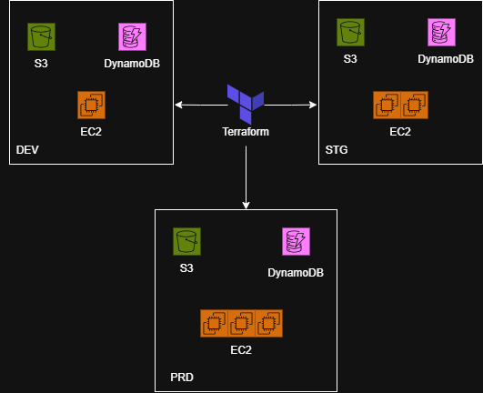

# Multi-Environment AWS Infrastructure Automation using Terraform

##  Project Overview

This project demonstrates the automated provisioning and management of AWS infrastructure across multiple environments using **Terraform Infrastructure as Code (IaC)**.

---

## Project Objectives

- Automate AWS infrastructure provisioning using Terraform.
- Create separate DEV, STG, and PRD environments.
- Maintain consistency across multiple environments.
- Reduce manual infrastructure configuration.
- Implement Infrastructure as Code practices.
- Make infrastructure reusable and version controlled.
- Scale infrastructure according to environment requirements.
- Simplify infrastructure creation and management.

---

## Architecture



---

The infrastructure is divided into three separate environments:

- **DEV (Development)**
- **STG (Staging)**
- **PRD (Production)**

Terraform is used to provision and manage AWS resources consistently across all environments.


Each environment has different infrastructure requirements.

| Environment | EC2 Instances | S3 | DynamoDB |
|-------------|---------------|----|----------|
| DEV         | 1             | 1  | 1        |
| STG         | 2             | 1  | 1        |
| PRD         | 3             | 1  | 1        |

This project demonstrates how Infrastructure as Code can be used to create scalable, consistent, and repeatable cloud infrastructure.

---

## Technology

| Technology | Purpose |
|------------|---------|
| Terraform | Infrastructure as Code and AWS resource provisioning |
| AWS EC2 | Compute resources |
| AWS S3 | Object storage |
| AWS DynamoDB | NoSQL database |
| AWS IAM | Identity and access management |
| Git | Version control |
| GitHub | Source code management |

---

## Terraform Commands — Complete Guide

### 1. Setup & Initialization

**Install Terraform (Linux/Ubuntu)**
```sh
wget -O - https://apt.releases.hashicorp.com/gpg | sudo gpg --dearmor -o /usr/share/keyrings/hashicorp-archive-keyring.gpg
echo "deb [arch=$(dpkg --print-architecture) signed-by=/usr/share/keyrings/hashicorp-archive-keyring.gpg] https://apt.releases.hashicorp.com $(lsb_release -cs) main" | sudo tee /etc/apt/sources.list.d/hashicorp.list
sudo apt update && sudo apt install terraform

# Verify installation
terraform -version
```

**Install Terraform (Linux/Amazon Linux)**
``sh
sudo yum install -y yum-utils shadow-utils
sudo yum-config-manager --add-repo https://rpm.releases.hashicorp.com/AmazonLinux/hashicorp.repo
sudo yum install terraform

# Verify installation
terraform -version
```
**Initialize Terraform**
```sh
terraform init
```
- Downloads provider plugins
- Sets up the working directory

### 2. Core Commands
```sh
terraform fmt           # Format code to standard style
terraform validate      # Validate syntax and configuration
terraform plan          # Preview changes without applying
terraform apply         # Create/update infrastructure
terraform apply -auto-approve  # Apply without confirmation
terraform destroy       # Destroy all managed resources
terraform destroy -auto-approve  # Destroy without confirmation
```

### 3. Managing State
```sh
terraform state list              # List all managed resources
terraform show                    # Show detailed resource info
terraform state mv <src> <dest>   # Move resource in state
terraform state rm <resource>     # Remove from state (not from cloud)
```

### 4. Variables & Outputs
```sh
terraform apply -var="instance_type=t3.small"  # Pass variable via CLI
terraform output                                # Show all outputs
terraform output ec2_public_ip                  # Show specific output
```

---

## Benefits of Terraform

- Infrastructure automation
- Infrastructure as Code
- Version-controlled infrastructure
- Reusable configurations
- Consistent environments
- Reduced manual errors
- Easy scaling
- Declarative infrastructure management
- Repeatable deployments


---

## Project Highlights

Infrastructure as Code  → Terraform
Cloud Provider          → AWS
Environments            → DEV / STG / PRD
Compute                 → EC2
Storage                 → S3
Database                → DynamoDB
Version Control         → Git / GitHub

---
